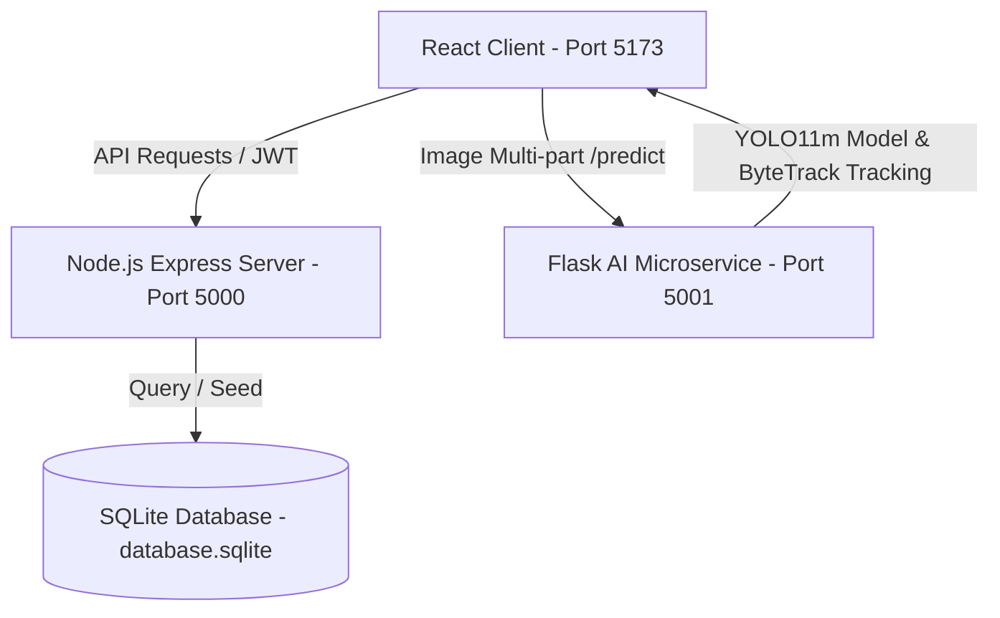

# 🏥 MEDjestic: AI-Powered Smart Hospital Waste Management System

MEDjestic is an advanced, compliant, and responsive Healthcare Waste Management OS designed to intelligently detect, classify, log, and audit hospital waste. Utilizing a three-tier architecture (React Frontend, Node.js SQLite Backend, and a Python Flask AI Microservice), the system helps clinical staff segregate waste at the point of use in accordance with WHO, CDC, and OSHA compliance guidelines.

---

## 🚀 Key Features

* **YOLO11 Custom Object Detection**: Replaced legacy classifiers with a custom production-grade YOLO11 architecture (`yolo11m.pt`) for real-time biomedical waste multi-object detection and bounding box overlays.
* **ByteTrack Object Tracking**: Integrated persistent tracking (`bytetrack.yaml`) that assigns stable, unique tracking IDs to objects (e.g. `Needles #1`, `Gloves #2`) across frames, preventing duplicate counts and eliminating box flickering.
* **Real-time FPS & Tracking Badges**: Live camera feed overlays real-time model inference speed (FPS) and unique tracking labels directly on the conveyor/webcam stream.
* **11 Clean Prediction Classes Mapped to Official Categories**:
  The AI scanner classifies objects into 11 detailed identification classes which are then mapped to the official compliance categories:
  
  | Identified Item Name (YOLO Output) | Compliance Category Name (WHO Bin) | Color Bin Category |
  |-------------------------------------|-------------------------------------|-------------------|
  | **Body Tissue or Organ**            | Biohazard Waste                     | Yellow Category   |
  | **Glass Equipment**                 | Sharps Waste                        | Yellow Category   |
  | **Metal Equipment**                 | Sharps Waste                        | Yellow Category   |
  | **Plastic Equipment**               | Recyclable Waste                    | Blue Category     |
  | **Paper Equipment**                 | Biohazard Waste                     | Yellow Category   |
  | **Syringe Needles**                 | Sharps Waste                        | Yellow Category   |
  | **Gauze**                           | Biohazard Waste                     | Yellow Category   |
  | **Gloves**                          | Infectious Waste                    | Red Category      |
  | **Masks**                           | General Waste                       | Black Category    |
  | **Syringes**                        | Sharps Waste                        | Yellow Category   |
  | **Tweezers**                        | Sharps Waste                        | Yellow Category   |
* **Real-time Camera Scan & Image Uploads**: Connect standard WebRTC webcam streams or drag-and-drop waste images to trigger instant YOLO11 detections.
* **Dynamic Department Analytics Synchronization**: Logged waste entries under new or unseeded departments automatically register in the database comparison tables, ensuring charts sync and update immediately.
* **Dual Login Portals & Tab Permissions**:
  * **Staff Login**: Access to **Dashboard**, **Waste Detection**, and **AI Recommendations** (previously Admin-only). Restricted from accessing **Reports Audit**.
  * **Admin Portal**: Fully unrestricted access to all panels including **Department Analytics**, **AI Recommendations**, **Reports Audit**, **Staff Directory** (with staff profile deletion capabilities), and **System Settings**.
* **Global Light & Dark Theme Toggle**: A toggle button in the header navbar lets users transition between clean clinical light mode and dark telemetry mode, persisting preferences in browser local storage.
* **Advanced NLP AI Chatbot Assistant**:
  * Voice dictation (Speech-to-Text) and audio playback response (Text-to-Speech).
  * Direct action quick-chips (Clear alerts, get stats, download logs).
  * Navigation commands (Switch tabs automatically by speaking *"go to scanner"* or *"show analytics"*).
  * Real-time compliance guidelines querying powered by Groq API (`llama-3.1-8b-instant`).
* **KPI Auditing & Analytics**: Donut charts for cleaning schedules, weekly waste trend line plots, and department comparison bar charts (measuring hazardous weights and carbon footprints).
* **Compliance Logs & Exports**: Secure SQLite logger that updates in real-time, complete with a downloader to export raw compliant CSV spreadsheets for health department inspectors.

---

## 📂 Project Architecture



### 1. Frontend UI (`/src`)
A modern glassmorphic dashboard built using **React (Vite)**, **Tailwind CSS**, **Recharts** (for data visualisations), and **Lucide Icons**. Includes auto-refresh locks that query the database immediately when you switch between tabs.

### 2. Backend API (`/server`)
An **Express.js** REST server that holds the SQLite database (`database.sqlite`). Handles JWT user authentication, real-time logging, department counter increments, critical overflow notifications, and compliance CSV compiler exports.

### 3. AI Object Detection Microservice (`/ai_service`)
Exposes a Flask prediction endpoint. Integrates custom **YOLO11** object detection and ByteTrack tracking pipelines. Supports CUDA GPU acceleration and FP16 half-precision inference.

---

## 🛠️ Installation & Setup

### Prerequisites
* **Node.js** (v18 or higher)
* **Python** (v3.10 or higher)
* **CUDA Toolkit & cuDNN** (Optional, for GPU acceleration)

### 1. Backend Server Setup
Navigate to the server directory, install dependencies, and start the node process:
```bash
cd server
npm install
node server.js
```
*The server will boot on `http://localhost:5000` and automatically create and seed the SQLite database with 21 days of historical waste records.*

### 2. AI Microservice Setup
Navigate to the AI service directory, install python dependencies, and launch:
```bash
cd ai_service
pip install -r requirements.txt
python app.py
```
*The Flask endpoint will run on `http://localhost:5001/predict`.*

### 3. Frontend Client Setup
Navigate to the root directory, install npm packages, and boot the Vite dev server:
```bash
npm install
npm run dev
```
*Open your browser and navigate to `http://localhost:5173/`.*

---

## 🔑 Default Credentials

Sign in on the landing page with either of the pre-loaded roles (using the respective portal tabs):
* **Staff Login**: `staff@medjestic.com` / `staff123`
* **Admin Portal**: `admin@medjestic.com` / `admin123`

---

## 🧠 YOLO11 Model Training & Kaggle Pipeline

The system is equipped with an optimized YOLO training dataset converter and training pipeline.

### Dataset Converter
Use [train.py](file:///d:/may/Medical/ai_service/train.py) to train a model. It automatically converts a standard classification image folder structure into YOLO object detection coordinates:
* Cleans and splits files (80% train, 20% validation).
* Generates centered labels (`.txt` files mapping coordinates).
* Configures `data.yaml` matching class index.
* Supports **subsampling** to prevent CPU-based training from bottlenecking.

### Manual Training
Run the training script locally using the optimized CPU parameters:
```bash
python train.py --model yolo11n.pt --imgsz 320 --max_images_per_class 150 --epochs 5 --batch_size 16
```
*Outputs `best.pt` inside the `ai_service` root directory.*

#### Command-line Arguments:
* `--model`: YOLO model weights architecture to train (default: `yolo11n.pt` for fast CPU training and inference).
* `--imgsz`: Image resolution size for training (default: `320` to optimize CPU throughput; standard is `640`).
* `--max_images_per_class`: Max images to sample per waste class (default: `150` to complete training in minutes, set to `-1` to use all images).
* `--epochs`: Number of epochs to train (default: `100`).
* `--batch_size`: Batch size (default: `16`).

### Kaggle Integration & Auto-Train
The Flask service [app.py](file:///d:/may/Medical/ai_service/app.py) is pre-configured to run inside a **Kaggle Environment**:
* At startup, if the dataset is detected at `/kaggle/input/pharmaceutical-and-biomedical-waste/`, the service **automatically spawns a background training thread** to train the YOLO11 model for 100 epochs if `best.pt` is missing.
* Once background training completes, the model weights are loaded and live webcam/uploads route directly to the custom YOLO11 detector!
